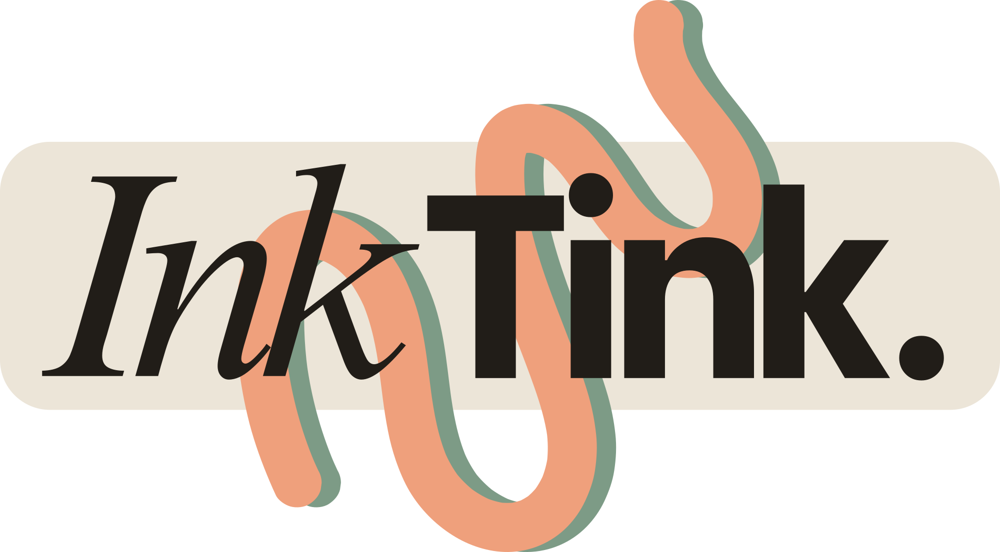

  

# [InkTink](https://sarahmit.github.io/InkTink/)

A creative writing workshop that lives in your browser. No account, no server, no subscription. Your projects stay in your own files.

InkTink is a hobby project I thought about for a long time and could finally realize with the help of Claude.

## Features

- **Writing** — chapters and scenes with a distraction-free editor, plus a notes panel per chapter and scene for what each one should show or achieve
- **Story languages** — write the same story in several languages; switch versions above the chapter list and keep the original open alongside while you write
- **Book cover** — add a cover image to your project; it shows in the sidebar and on the home page, and can be the first page of a Word export
- **Plot Notes** — a board of categorised notes: ideas for the story, open questions to decide, research notes, references & sources, or your own categories
- **Story Beats** — structure your plot with beat boards
- **Characters** — character profiles with images
- **Worldbuilding** — entries for places, objects, lore, and custom categories
- **Timeline** — visual scene and event timeline
- **Theme** — capture your story's theme, question, and message
- **Moodboard** — collect images for atmosphere and inspiration
- **Brainstorming** — a freeform canvas for notes and ideas
- **Stats** — word count, writing goals, and progress over time
- **Export** — download your manuscript (or one chapter, in any story language) as Word, Markdown, or plain text

## Make it yours

Open **Settings** with the ⚙ button in the top bar. Settings come in two kinds:

**This device** (stays in this browser or desktop app)

- **Colour scheme** — light, sepia, high contrast, dark, night, or follow your system
- **Accent colour** — sage, terracotta, blue, plum, amber, rose, or teal
- **Editor typography** — font, size, line spacing, and text width, with a live preview
- **Focus mode** — hides everything but your text (⛶ Focus in the editor toolbar, or Ctrl+Shift+F; Esc leaves it), with optional typewriter scrolling and dimming of every paragraph except the current one
- **Navigation** — hide pages you don't use from the left bar and change their order
- **On start** — open the home page, or continue right where you left off

**This project** (saved with the project, so it travels with Export and Import)

- **Scene statuses** — your own stages instead of Draft / Revised / Done, each with a colour
- **Book-style paragraphs** — indent the first line of each paragraph, in the editor and in Word exports
- **Word targets** — per chapter and scene, set in the 📌 notes panel; progress bars appear in the chapter list
- **Colours** — for chapters and Plot Notes categories
- **Export layout** — font, size, and line spacing for Word; scene breaks (titles, * * *, #, blank line) and chapter headings ("Chapter 1: Title") for all formats

## Your data & privacy

Project files are saved only in your browser's local storage — nothing is ever sent to a server, and nobody but you can see your writing. To back up or move a project to another device, use the **Export** button to download a `.json` file and **Import** to open it again.

Two things to keep in mind:

- **Your projects live in this browser, on this device.** They are stored unencrypted, like a document file on your disk. Anyone who uses the same computer account and browser could open InkTink and read them.
- **On a shared or public computer** (library, work, a friend's laptop), either use a **private/incognito window** — everything vanishes when you close it — or use **"Delete all data from this browser"** at the bottom of the home page when you're done. That dialog also offers a full backup download (every project plus the idea pool in one file) which **Import** can restore later.

**No AI reads your writing.** InkTink has no AI features and sends nothing anywhere. InkTink is developed with the help of an AI coding assistant, and the development setup only lets that assistant work on the code, never on stories: it is blocked from opening the desktop data folder, project exports and backups, and the browser storage that holds projects.

And as with anything that lives in a browser: clearing your browsing data deletes your projects too, so export a backup now and then.

## Offline & mobile

InkTink works as a [Progressive Web App](https://developer.mozilla.org/en-US/docs/Web/Progressive_web_apps). After your first visit it loads without an internet connection. On a phone or tablet you can add it to your home screen for a full-screen, app-like experience.

## Desktop app

The same InkTink without the browser's storage limit: projects live as plain `.json` files in `Documents/InkTink/` (deleted ones go to `trash/`, never destroyed). [Download an installer](https://github.com/SarahMit/InkTink/releases) — on Windows it auto-updates.

Web and desktop are fully compatible: the files use the exact same format as **Export**/**Import**. To move in, export a backup in the browser and import it in the app (or drop `.json` exports into `Documents/InkTink/projects/`).

**Development:** `cd desktop && npm install && npm start`. **Release:** `git tag desktop-v0.1.0 && git push --tags` — GitHub Actions builds the installers and publishes the Release; the tag sets the version. macOS builds are unsigned: no auto-update, first launch via right-click → Open.
